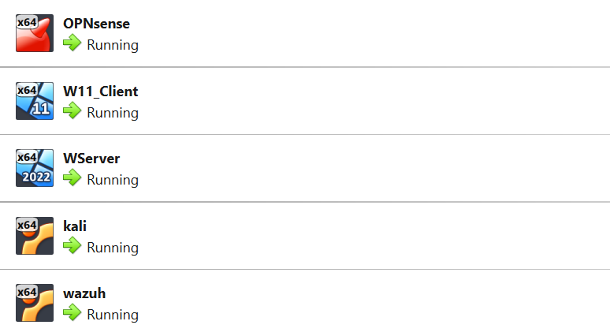
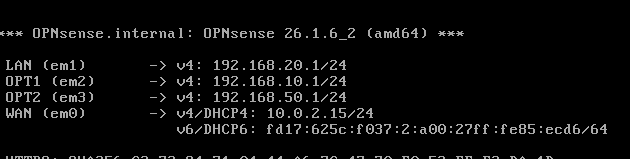
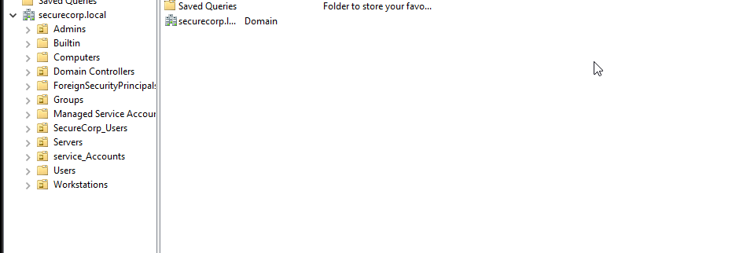
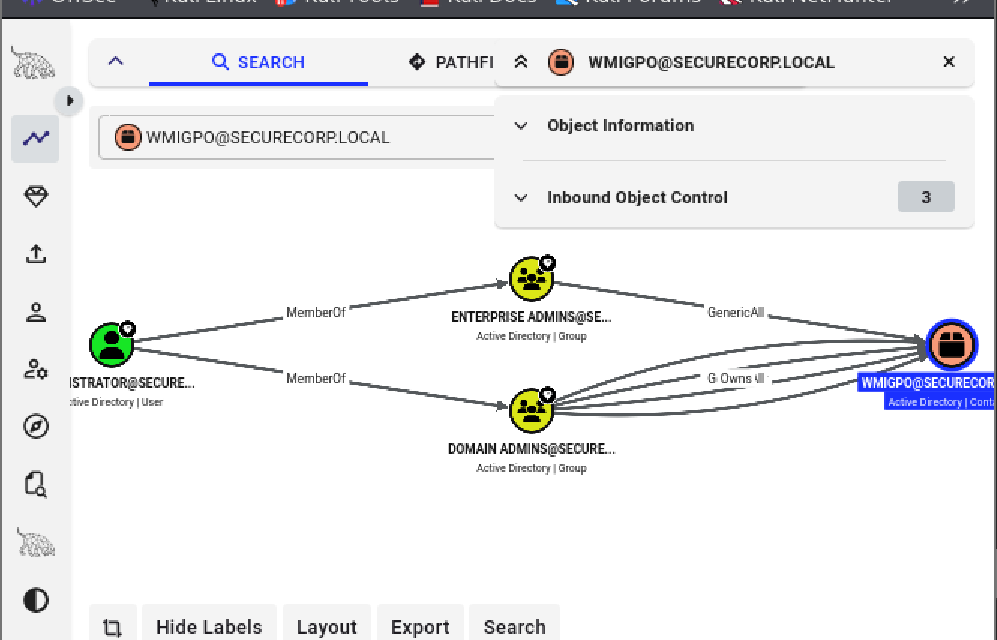
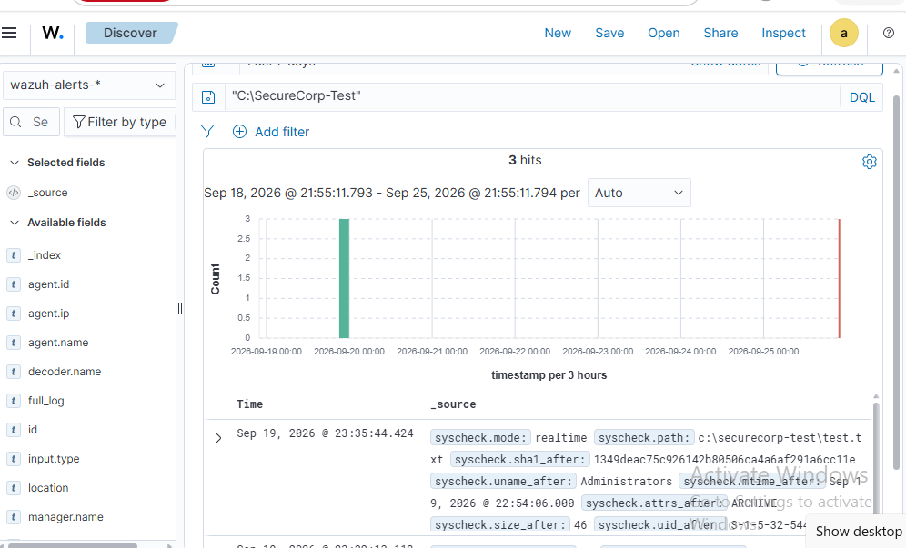
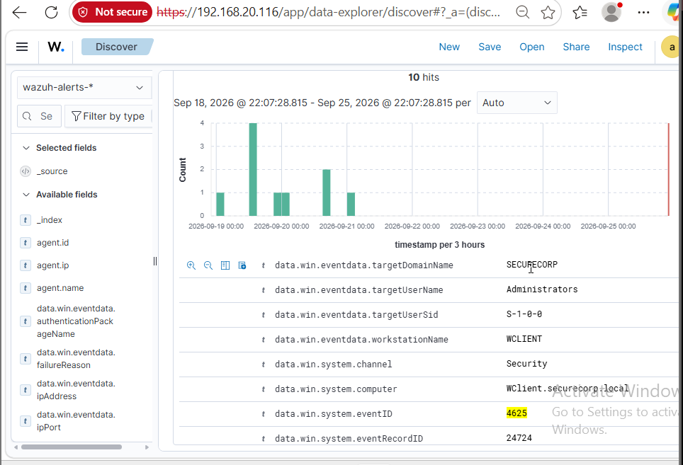
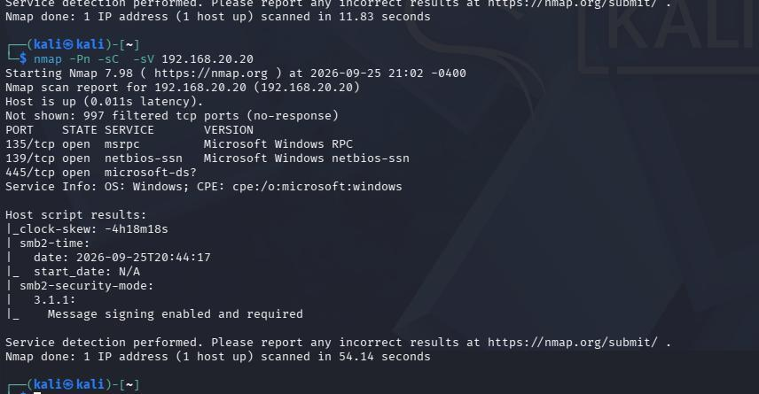

# SecureCorp Cybersecurity Lab

**A virtualized enterprise environment for SOC / SIEM monitoring, Active Directory security and controlled offensive security.**


---

## Overview

SecureCorp is a virtualized lab that reproduces a simplified enterprise infrastructure in order to study security monitoring from the perspective of an analyst. It combines an **OPNsense** firewall, an **Active Directory** domain, a **Windows 11** endpoint, a **Kali Linux** machine and a **Wazuh** monitoring platform.

The goal is not only to carry out attacks, but above all to understand **how security activity is generated, collected, analyzed and documented**.



## Objectives

- Build a segmented network infrastructure with OPNsense
- Deploy an Active Directory domain with users, groups, OUs and GPOs
- Analyze Active Directory relationships with BloodHound
- Deploy Wazuh and connect a Windows endpoint
- Collect Windows events, Sysmon events, FIM, SCA and inventory data
- Perform controlled network reconnaissance from Kali
- Observe the resulting events in the SIEM
- Map selected activities to MITRE ATT&CK

## Architecture

```
            INTERNET / NAT
                  │
                  ▼
          ┌───────────────┐
          │   OPNsense    │
          │   Firewall    │
          └───────┬───────┘
      ┌───────────┼────────────┐
      ▼           ▼            ▼
 Corporate Net  Attack Net  Target Net
192.168.20.0/24 192.168.10.0/24 192.168.50.0/24
      │             │
  SERVER01          Kali
  WCLIENT
  WAZUH
```

### Network Plan

| Interface | Device | Address | Role |
|---|---|---|---|
| LAN | em1 | 192.168.20.1/24 | Corporate network |
| OPT1 | em2 | 192.168.10.1/24 | Attack network |
| OPT2 | em3 | 192.168.50.1/24 | Target network |
| WAN | em0 | 10.0.2.15/24 (DHCP) | Internet / NAT |

### Machines

| Machine | System | IP Address | Function |
|---|---|---|---|
| Kali | Kali Linux | 192.168.10.100 | Reconnaissance |
| WCLIENT | Windows 11 | 192.168.20.20 | Endpoint |
| WAZUH | Ubuntu Server | 192.168.20.116 | SIEM / Monitoring |
| SERVER01 | Windows Server | 192.168.20.10 | Active Directory domain controller |



## Technology Stack

| Category | Tools |
|---|---|
| Virtualization | Oracle VirtualBox |
| Firewall / Router | OPNsense |
| Identity | Active Directory (`securecorp.local`), Group Policy |
| AD analysis | BloodHound, bloodhound-python |
| SIEM | Wazuh (Manager, Indexer, Dashboard) |
| Endpoint telemetry | Wazuh agent, Sysmon, Windows Security events, PowerShell logs |
| Monitoring modules | File Integrity Monitoring, Security Configuration Assessment, Syscollector |
| Offensive tooling | Kali Linux, Nmap |
| Framework | MITRE ATT&CK |

## Key Features

### Active Directory
- Domain `securecorp.local` with `SERVER01` as domain controller
- One sub-OU per department under `SecureCorp_Users`: Finance, HR, Interns, IT, Management, Sales
- Security groups: `Finance_Users`, `HR_Users`, `IT_Admins`, `IT_Users`, `Managers`, `Sales_Users`
- Group Policy for centralized workstation administration



### BloodHound Analysis
Collected from Kali with `bloodhound-python`:

| Object type | Collected |
|---|---|
| Domains | 1 |
| Computers | 2 |
| Users | 15 |
| Groups | 58 |
| GPOs | 2 |
| OUs | 13 |
| Containers | 19 |



### Wazuh Monitoring
The Wazuh agent on WCLIENT sends the following to the Wazuh server:

- Windows Security events
- Sysmon events (Event ID 1: Process Creation)
- File Integrity Monitoring events
- SCA results (CIS Microsoft Windows 11 Enterprise Benchmark)
- Syscollector inventory (hardware, OS, network, packages, ports, processes, users, services)
- PowerShell Operational logs



### Windows Events Studied

| Event ID | Description |
|---|---|
| 4624 | Successful logon |
| 4625 | Failed logon |
| 4688 | Process creation |
| 4720 | User account created |
| 4728 | Member added to a security-enabled global group |
| 4732 | Member added to a security-enabled local group |



### Network Reconnaissance Scenario

```bash
nmap -Pn -sV -sC 192.168.20.20
```

| Port | State | Service |
|---|---|---|
| 135/tcp | open | msrpc |
| 139/tcp | open | netbios-ssn |
| 445/tcp | open | microsoft-ds |

The remaining 997 ports were filtered, and SMB2 message signing was reported as enabled and required.



## MITRE ATT&CK Mapping

This is a documentary mapping and does not imply that every technique was executed in full.

| Activity | Technique | Description |
|---|---|---|
| Network scanning | T1046 | Network Service Scanning |
| PowerShell | T1059.001 | Command and Scripting Interpreter: PowerShell |
| Process discovery | T1057 | Process Discovery |
| Account discovery | T1087 | Account Discovery |
| Use of a valid account | T1078 | Valid Accounts |

## What Each Activity Looks Like in the SIEM

| Activity | Visible through |
|---|---|
| Nmap scan | Network activity |
| PowerShell execution | Process and command activity |
| File modification | File Integrity Monitoring |
| Authentication failure | Windows Security event |
| System configuration | Security Configuration Assessment |

The main lesson: a monitoring solution should not rely on a single data source. Correlating Windows events, Sysmon, FIM, SCA, inventory and network telemetry gives much fuller visibility.

## Repository Structure

| Folder | Content |
|---|---|
| [`docs/`](docs/) | Full technical report (PDF) |
| [`architecture/`](architecture/) | Network design, IP plan, virtual machines |
| [`active-directory/`](active-directory/) | Domain, OUs, groups, GPOs, BloodHound |
| [`wazuh/`](wazuh/) | SIEM deployment, Sysmon, FIM, SCA, Windows events |
| [`offensive-security/`](offensive-security/) | Reconnaissance scenario and MITRE ATT&CK mapping |
| [`evidence/screenshots/`](evidence/screenshots/) | Supporting screenshots (Fig. 1 to 23) |

## Skills Demonstrated

- Network segmentation and firewall configuration (OPNsense)
- Active Directory administration and hardening concepts
- SIEM deployment and log analysis (Wazuh)
- Endpoint monitoring (Sysmon, FIM, SCA, Windows event logs)
- Active Directory attack-path analysis (BloodHound)
- Controlled reconnaissance (Nmap)
- Mapping activity to MITRE ATT&CK
- Technical documentation

## Full Report

The complete technical report is available here: [`docs/SecureCorp_Cybersecurity_Lab_Technical_Report.pdf`](docs/SecureCorp_Cybersecurity_Lab_Technical_Report.pdf)

## Ethical Notice

All activities were performed inside an isolated virtual lab, on machines owned by the author, for **educational purposes only**. Do not use these techniques against systems you do not own or do not have explicit written permission to test. No credentials or secrets are published in this repository.

## Author

**Fatima Ezzahrae Ouhmich**
Cybersecurity and Embedded Systems Engineering, ENSA Tetouan


## License

This project is licensed under the Mozilla Public License 2.0. See the [LICENSE](LICENSE) file for details.
